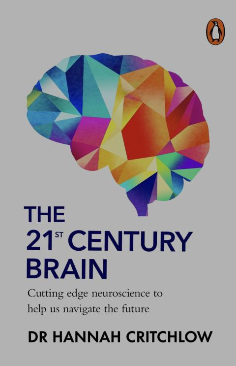

# 2026-11

## 2026-11-13 Friday  🌐 🎬 💾 📚 📑 🔬

### RocketEDA Engine

💾[RocketEDA Engine](https://github.com/Team-RocketEDA/rocket-engine)

rocket-engine is RocketEDA's headless Python engine for chip-design projects. It owns the shared operation surface, project revisions and events, tool dispatch, capability reporting, and verification evidence used by manual clients and the agent harness.

💾[RocketEDA RocketIDE](https://github.com/Team-RocketEDA/RocketIDE)

RocketIDE is a chip-design workbench where you and an AI agent work on the same project at the same time. You describe what you want; the agent writes the design, runs real EDA tools and explains the result. You watch it take shape, point at what you want changed, and can do all of it by hand. Whether a check passes is decided by the engine's measurements, never by what the agent says.

---

### 黃仁勳如何開脫

媽寶型 都是台灣電子大老帶壞我的

律師型 經過精密的檢驗 黃先生前額葉腦區有血液供應減少的情況 因此判斷力下降 是身體出狀況了

---

### Baochip-1x: A Mostly-Open, 22nm SoC For High Assurance Applications

🌐[Baochip-1x](https://hackaday.com/2026/11/12/baochip-1x-a-mostly-open-22nm-soc-for-high-assurance-applications/)

---

### The 21th Century Brain

2026-060

---

## 2026-11-12 Thursday  🌐 🎬 💾 📚 📑 🔬

### openFPGALoader (Copy EEPROM)

openFPGALoader -c ft232 --fpga-part xc7a35tfgg484 --dump-flash --file-size 8388608 -o 0 b.bin

openFPGALoader -c ft232 b.bin

openFPGALoader -c ft232 --fpga-part xc7a35tfgg484 --bulk-erase

openFPGALoader -c ft232 --fpga-part xc7a35tfgg484 -f b.bin

dd if=your_file.bin of=output_file.bin bs=1M count=8

---

### Building Your First AI Agent in Python with the OpenAI Agents SDK

🌐[Building Your First AI Agent in Python with the OpenAI Agents SDK](https://www.kdnuggets.com/building-your-first-ai-agent-in-python-with-the-openai-agents-sdk)

---

### Single Producer Single Consummer Lock-Free, Wait-Free FIFO (Circular Buffer)

---

### Inter-Process Queue

---

### C++HDL

[C++HDL](https://github.com/mirekez/cpphdl)

C++HDL is a Hardware Description Language framework built over C++RTL dialect. It's

Open Source flow from C++RTL models to SystemVerilog or gates level output
10-50x Faster simulation (run) for digital and analog, based on registers, clocks, gates and transistors
Digital and Analog in one bottle - you can deliver your models simulation as binary, link to third patry IP
Build very large RTL models in C++ and run them on clusters and GPUs, integrate through streams
HLS and Synthesis layers with retiming capabilities to translate generic C++ classes to C++RTL or gates level

!!! C++RTL natively reflects SystemVerilog or VerilogA: register to register, clock to clock, transistor to transistor - no transformation happens between them. It supports both direction conversion just by language substitution.

---

### 富人越來越富，也越來越壞

🌐[富人越來越富，也越來越壞](https://cn.nytimes.com/opinion/20261111/rich-people-martha-stewart-midterms/zh-hant/)

大量研究已經證明，巨額財富會把人的腦子燒壞。海倫·裡斯和莉茲·內波倫特在《同理心效應》一書中寫道：「科學研究表明，權力與同理心之間存在反比關係。這種距離往往使富人和權貴與普通人的苦難隔絕開來。」一個人越富有，生活圈子就越封閉，也就越脫離現實。金錢成了他們與其他富人比較的標尺。他們不必為房租、汽車加油或在超市買不買得起碎牛肉而發愁。只要足夠有錢，你的醫生很可能連醫療保險都不接受——而你也根本不需要他接受。

---

### Real-Time Data Acquisition: DMA, Buffers, Sample Rate Limits

🌐[Real-Time Data Acquisition: DMA, Buffers, Sample Rate Limits](https://digilent.com/blog/real-time-signal-acquisition-resource-constrained-systems/)

---

## 2026-11-11 Wednesday  🌐 🎬 💾 📚 📑 🔬

### STM32 Bare-Metal

💾[STM32 Bare-Metal](https://github.com/lowbyteproductions/bare-metal-series)

This series is all about building bare-metal firmware for a Cortex-M4 STM32 microcontroller, using open source tools and libraries such as GCC and libopencm3. The project will cover everything from blinking an LED, to building a bootloader for performing firmware updates over UART/USB, to building a signed firmware security mechanism that allow only authorised code to run on the device. Stretch goal content includes breaking the security we build, as well as exploring more peripherals, applications, and algorithms in depth.

🌐[Microcontrollers: Interrupt-safe ring buffers](https://www.downtowndougbrown.com/2013/01/microcontrollers-interrupt-safe-ring-buffers/)

---

## 2026-11-10 Tuesday  🌐 🎬 💾 📚 📑 🔬

### Blinky To Bootloader: Bare Metal Programming Series

🎬[Blinky To Bootloader: Bare Metal Programming Series](https://www.youtube.com/playlist?list=PLP29wDx6QmW7HaCrRydOnxcy8QmW0SNdQ)

---

### Kotlin 2026: Layoffs, AI, Google — Is the Golden Age Over? Jake Wharton Explains

🎬[Is the Golden Age Over? Jake Wharton Explains](https://www.youtube.com/watch?v=9WjPdgOK-68)

Jake Wharton quit his job at Cash App in November 2025, in the middle of massive tech layoffs. After that, he published nine values for his next employer, number one was "No AI." Jake explains why and what else made the list.

🌐[A Kotlin Legend Turned Down 80% of the Job Market: Why I Flatly Refuse to Use AI for Code](https://mings.in/en/posts/jake-wharton-ai/)

As I see it, they are built on large-scale use of copyrighted content. Model training ignored artists’ copyright and ignored open source licenses.

Being able to access something on the internet does not mean you have the right to recombine it, rewrite it, or output it verbatim.

---

### Nengo Brain Maker

🌐[Nengo Brain Maker](https://www.nengo.ai/)

The Nengo Brain Maker is a Python package for building, testing, and deploying neural networks.

---

### Lock Free Programming

🎬[Lock Free Programming](https://www.youtube.com/@moon-writes-code/videos)

---

### Zephyr loader on Arduino Board

🌐[Zephyr loader on your board](https://support.arduino.cc/hc/en-us/articles/29180434600476-Install-the-Zephyr-loader-on-your-board)

---

## 2026-11-09 Monday  🌐 🎬 💾 📚 📑 🔬

### Low-Latency Lock-Free Utilities

💾[Low-Latency Lock-Free Utilities](https://github.com/sadhbh-c0d3/lock-free)

🌪️ Low latency is nanoseconds! Every CPU cycle matters. You want to fit evreything in Level 3 cache. You want to pin threads to CPU cores. You want lock-free and wait-free programming, so that your threads run at full throtle without any interruptions!

---

🎬[Low Latency Gal Presents: Low Latency Stuff by Sonia Kolasinska](https://www.youtube.com/watch?v=KwSWLVUANxY&list=PLAetEEjGZI7OUBYFoQvI0QcO9GKAvT1xT&index=3&t=2613s)

---

## 2026-11-06 Friday  🌐 🎬 💾 📚 📑 🔬

### Different Mind Set , Different Communication, Different Team Mood.

---

### 回憶苦妓

2026-059

不是苦妓的回憶錄 是 回憶與一位憂鬱的妓女的點點滴滴

---

### 寫作的本事

2026-058

---

## 2026-11-05 Thursday  🌐 🎬 💾 📚 📑 🔬

### Designing a Serial Link from Scratch

📚[Designing a Serial Link from Scratch](https://www.thebricd.org/serdes-tutorial/)

A design tutorial for undergraduate engineers building an open-source high-speed SerDes in 130 nm SiGe BiCMOS. Channels, link budgets, equalization, transmitter and receiver circuits, jitter, PLLs and clock recovery, the open-source design flow, and hands-on labs.

---

### After test Pico Micropython I2C Memory Read/Write Function to Max96716 and Max96717, I decide to  Call it A Day.

    I learn something interesting in every step I take.
    I cannot stand for AI super speed code genertion. 
    ...
    It is time to say goodbyte to software.

---

## 2026-11-04 Wednesday  🌐 🎬 💾 📚 📑 🔬

### LTC4364 surge stopper

    LTC4364

    The LTC4364 surge stopper with ideal diode controller protects loads from high voltage
    transients. It limits and regulates the output during an overvoltage event, such as load dump
    in automobiles, by controlling the voltage drop across an external N-channel MOSFET pass
    device. The LTC4364 also includes a timed, current limited circuit breaker. In a fault
    condition, an adjustable fault timer must expire before the pass device is turned off. The
    LTC4364-1 latches off the pass device while the LTC4364-2 automatically restarts after a
    delay. The LTC4364 precisely monitors the input supply for overvoltage (OV) and undervoltag
    (UV) conditions. The external MOSFET is held off in undervoltage and auto-retry is disabled in
    overvoltage.

---

### Lattice CrossLink-NX Configuration Guide (Slave SPI Mode)

📑[Lattice CrossLink-NX Configuration Guide](../papers/2026/FPGA-TN-02014-1-8-CrossLink-Programming-Config-User-Guide.pdf)

Pay Attention to "CrossLink SSPI SRAM Configuration Flow"

---

### 英探險家完成徒步環球28年旅程 行走5萬公里創世界紀錄

🌐[行走5萬公里創世界紀錄](https://news.pts.org.tw/article/834080)

57歲英國探險家布希比2日重返家鄉，結束28年徒步環球之旅，總共行走逾5萬公里，跨越30個國家，創下2項世界紀錄。布希比75歲的母親在兩人重逢時含淚說道「我們都老了」；布希比則表示，這趟旅程收穫無數陌生人的善意，並非孤軍奮戰。

---

## 2026-11-03 Tuesday  🌐 🎬 💾 📚 📑 🔬

### Build the web for agents, not agents for the web

📑[Build the web for agents, not agents for the web](https://arxiv.org/abs/2506.10953)

---

### 告訴我你吃什麽 我就知道你是誰

2026-057

---

## 2026-11-02 Monday  🌐 🎬 💾 📚 📑 🔬

### neo-pi bare-metal Neo Geo emulator for Raspberry Pi 3 & 4.

💾[neo-pi](https://github.com/alessioscand/neo-pi)

A streamlined bare-metal Neo Geo emulator for Raspberry Pi 3 & 4.

---

### openCologne-PCIE

💾[openCologne-PCIE](https://github.com/chili-chips-ba/openCologne-PCIE)

openCologne-PCIE is a soft PCIE EndPoint core for the Cologne Chip GateMate FPGA, built with the fully opensource nextPNR tool suite. It continues openCologne and complements the openPCIE RootComplex.

---

### LLM 產生的東西如果侵犯專利 ？

---