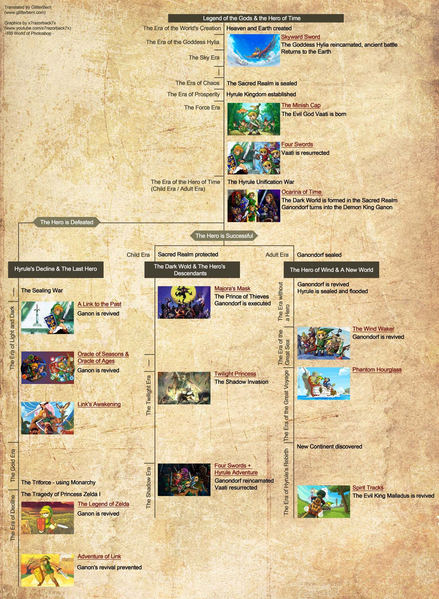

# Game Notes

## Obvilion

### 偷竊前要儲存

### Switch 2 Button 

Traditional Controller Layout

When using the system in handheld mode or with an NS2 Pro Controller, the standard button functions map as follows: [1, 2]

- ZR / Right Trigger: Attack
- ZL / Left Trigger: Block
- R Button: Cast Spell
- L Button: Ready / Sheathe Weapon
- A Button: Activate / Interact / Grab (Hold)
- B Button: Character Journal / Main Menu
- X Button: Jump
- Y Button: Quick-key Modal Menu
- Left Stick Click (L3): Sneak / Crouch
- Right Stick Click (R3): Toggle First/Third-Person Camera View
- Minus (-): Wait
- Plus (+): Pause Menu
- D-Pad: Direct Quick-key Selection (cardinal and diagonal slots)

---

### 治療吸血鬼症

    在《上古卷軸4：湮沒》（Oblivion）中治療吸血鬼症，最快的方法是前往 DLC 區域「深淵裂谷」（Deepscorn Hollow）使用淨化噴泉，或是解長篇的官方支線任務。 [1, 2]
    方法一：快速治療（利用 DLC 深淵裂谷）
    前往地圖南方的 Deepscorn Hollow（深淵裂谷，水下有入口）。
    在房間角落採集淨化血鹽（Purifying Blood Salt）。
    對著房間內的重生噴泉使用，即可瞬間治癒吸血鬼症，免去繁瑣任務。 [1]
    方法二：正規解藥任務（Cure Vampirism）
    如果你已經完全變成吸血鬼（過完三天且睡過覺），染病狀態已無法用一般治癒疾病藥水消除，必須尋求女巫協助： [1, 2]
    觸發任務：跟帝都奧術大學的 Raminus Polus 或黑暗兄弟會的 Vicente Valtieri 交談，打聽解藥下落。 [1]
    尋找女巫：前往斯金格拉德（Skingrad）城堡找管事問伯爵，接著去找女巫 Melisande。 [1]
    準備材料：
    5個空的特大靈魂石（Empty Grand Soul Gems）
    6大蒜、5夜茄、3血草
    1個強效吸血鬼灰燼（Powerful Vampire Dust）
    用女巫給的匕首刺中亞龙人（Argonian）取得血液。 [1, 2]
    完成解藥：將材料交給女巫製作解藥，喝下後即可恢復正常。 [1, 2]
    小提示：在剛感染到「紫羅蘭血吸血鬼病」（Porphyric Hemophilia）的 3天潛伏期內，直接吃「治癒疾病藥水」或去神殿祈禱，就能直接阻止發作，不用變吸血

---

### Oblivion Gate 沒有必須要解

### Amazing Things You Want To Get Early In Elder Scrolls Oblivion Remastered

🎬[Amazing Things You Want To Get Early](https://www.youtube.com/watch?v=QngigWUPXiE)

- Chillrend
- Fin Gleam 水下呼吸
- Umbra

---

### Insanely Powerful RAREST ITEMS in Oblivion Remastered

🎬[Insanely Powerful RAREST ITEMS in Oblivion Remastered](https://www.youtube.com/watch?v=oYWetzZyDyg)

---

## 龍族教義2 黑暗再臨

### 地圖

[龍族教義2 黑暗再臨 地圖](https://www.gamersky.com/tools/map/dragonsdogma2/?ref=BZ&pageType=pc)

[龍族教義2 黑暗再臨 地圖 with DLC](https://www.gamerguides.com/dragons-dogma-2/maps/world-map)

---

### 主線 支線任務 與順序

由於《龍族教義2》的任務彼此交錯，且主線任務進度會作為關鍵節點（稱為「斷點」）導致某些支線或限時任務過期消失，最合理的優先度排列即為「保證所有支線、限時與好結局任務皆不漏掉的最優通關解任務順序」。

綜合文章中提到的所有條件（限時提醒、消失節點、良好結局前置關係），為您整理 1 到 76 的任務建議完成優先度清單：

#### 第一階段：營地與梅爾威初期（主線進王城前）

1. 從監獄甦醒（主線：序章）
2. 起始之地（主線）
3. 源自毀滅之村（主線）
4. 補給隊員的煩惱（營地支線）
5. 新兵受難記 ⚠️ 【限時】（先救阿卡德）
8. 小小的冒險（梅爾威：遇芙蘿拉，影響日後買東西折扣）
9. 水邊的蜥蜴（梅爾威支線）
10. 兄弟的努力（梅爾威：拯救諾伯特，影響任務45免費拿劍）
11. 獸人教官 → 布連的執著（營地/月光花庭園：解鎖鬥士大師技能）
7. 獨眼的襲擊（主線：跟隨團長前往王城途中觸發）
6. 王城之都（主線：抵達王城）

#### 第二階段：王城前期與周邊鋪陳（在推進主要主線前優先處理）

14. 腳下的真相 💡 【關鍵前置】（貧民區找地下書庫，必須先於任務23完成）
13. 救護之家的少女（貧民區：為黛芙妮送藥送礦石，影響任務17）
17. 貴族宅邸的少年（富裕區：給予正確建議藥劑以獲得好結局）
19. 機關盒之緣 ⚠️ 【極高優先/會在主線22後消失】（給資助並連續對話幾天完成）
27. 心血來潮的旅人（王城平民區：看家一週，後續可買自宅）
15. 進步的阻礙 💡 【建議與21同步】（解鎖鬥士、巫師職業）
20. 棲息於海角的魔物（哈波村：擊退蜥蜴人，影響任務43）
21. 討伐魔物（主線：貝恩德任務，建議去特雷佛礦山時同步拿雙手劍與大杖完成任務15）
22. 蒂莎的陰謀（主線：潛入公妃房間。完成後任務19會消失！）
23. 營救法務官 💡 【好結局條件】（帶鑰匙救人，因已有任務14基礎可順利引導他至地下書庫）
24. 騷亂之村（主線：探訪無名村，取得盜賊大師技能）
26. 接近覺醒者的黑影（王城商業區：抓跟蹤狂，抓入獄可拿到更好的關口通行證）
28. 夫妻情誼 ⚠️ 【限時5日】（救援葛雷格爾團長）
32. 前往牛車大道 ⚠️ 【限時/會在任務33後消失】（坐牛車送信給倫納特）
33. 災難降臨（梅爾威：擊退巨龍，解鎖魔劍士職業。完成後任務32會消失！）
25. 偽王的計畫（主線：參加舞會竊聽密談）
30. 籠中的公子 💡 【建議與25同步】（舞會中將信交給派崔克）
31. 法務官和文明利器 💡 【建議與25同步】（舞會儲藏庫拿法務官眼鏡）

貴族的贈禮 ⚠️ 【限時】（舞會被栽贓，盤查前把寶杖丟掉或給別人）

#### 第三階段：關口鎮、精靈村與大師技能收集

34. 鎮魂之鐘（古戰場遺跡：護送奧斯卡，順便拿《亡國喪鐘》魔法書）
35. 下落不明的寶石（關口鎮：可在贗品屋複製寶石進行交差）
36. 被擄走的少年 ⚠️ 【限時】（關口鎮：夜晚順著月光花跟蹤救羅傑，拖太久少年會死亡）
12. 煩惱的嫩枝（王城武器店外接取：送弓並示範）
40. 小樹的潛力（精靈村：救妹妹杜蘭，獲得弓箭手大師技能）
41. 於古綠之森 → 走出古綠之森（精靈村/巴塔爾工坊：收集石龍灰救精靈樹）
37. 魔法師的信念 💡 【雙大師技能操作】（關口鎮米爾汀：將魔法書複製贗品繳交給米爾汀，得《龍捲風》）
38. 追尋夢想 💡 【雙大師技能操作】（艾妮的家朵莉夏：將正本魔法書繳交給朵莉夏，得《流星火雨》與《神之鼓舞》）
29. 年輕雕刻家的煩惱（王城/巴塔爾：前往獅鷲巢穴完成雕刻）

#### 第四階段：王城後半重大變革（重大斷點前夕）

39. 危險的接觸（主線：潛入阿洛多辦公室，跳窗逃離觸發威廉明娜掩護）
44. 陰鬱薔薇園 ⚠️ 【限時3天/好结局條件】（蒐集收賄與殺人兩份證據交給威廉明娜，並請求貝恩德協助）
43. 不和的海角 💡 【前置】（哈波村：營救村民，影響任務45）
45. 背井離鄉之日 💡 【好結局條件】（梅爾威：因先前完成任務10可免費拿4把劍；完成任務33與43讓梅爾威村民順利移居哈波村）
42. 謊言之宴 🚨 【重大劇情斷點】（主線：穿謁見套裝參加登基大典。完成後大量王城舊任務將強制消失，請務必確認 1~43 號任務已全數處理完畢）

#### 第五階段：前往巴塔爾（火山/沙漠區域）

46. 月隱於雲（王城：將斯芬信件交法務官解讀，後往巴塔爾禁術研究所）
47. 火之國（主線：持通行證前往巴克巴塔爾酒館）
48. 掠奪與慈悲（關口鎮巴塔爾側：跟蹤雨果並剿滅赤蛇團據點）
49. 火之國的陰影（主線：海岸找安布羅修斯、拜訪神諭者與龍識者，解鎖幻術師）
50. 喜歡毒物的研究家（巴塔爾：協助亞爾研究毒物）
51. 樹蔭下的決意（巴塔爾：幫助雨果決定未來去向）
52. 聖焰修道院的祈禱（巴塔爾：協助梅內拉進行調查）
53. 決意之劍（巴塔爾：幫莎拉修復神劍）
54. 鋼鐵決心的貫徹（巴塔爾：莎拉鍛造神劍後續）
55. 賢者之石與斯芬克斯的試煉（前段）（山頂神殿：解答前 5 個謎題）
56. 賢者之石與斯芬克斯的試煉（後段）（邊境神殿：解答後續謎題並擊敗斯芬克斯）
57. 發掘現場的奴隸（火山島：前往發掘現場探尋情報）
58. 燭火的假象（巴塔爾：保護納迪尼亞女王）
59. 帶有毒氣的魔窟（巴塔爾：調查毒氣洞窟）
60. 穿過毒霧的刺客（巴塔爾：查出針對女王的暗殺陰謀）
61. 醉意中的大導師（火山島：為魯斯蒙尋找三瓶蜥蜴酒，解鎖魔弓手職業與大師技能）
62. 帶有魔力的巨輪（火山島：幫龍脈鍛造師找尋材料）
63. 跨越山脈的護送（火山島：護送腰痛老者腰頭前往溫泉，解鎖大劍師/魔弓手相關任務）

#### 第六階段：主線後期與進入終局前夕

64. 新的神路（主線：在巴塔爾禁術研究所製作「神空之輪」魂魄劍）
65. 護衛的職責（火山島：護送火山島營地關鍵人物）
66. 殘存的希望（火山島：協助營地防禦）
67. 追尋神的腳步（主線：前往塔雷佛礦山與龍識者交談）
68. 巨型魔像的威脅（火山島：擊敗巨大的塔洛斯魔像）
69. 意志的交鋒（主線：前往月光塔與阿洛多交鋒）
70. 龍之鼓動（主線：最後前往月光塔頂端迎接與巨龍的決戰）

#### 第七階段：無底深淵／真終局（Unmoored World 真世界）

註：以下為進入遊戲真正的結局「無底深淵」後的各區域最後避難與決戰任務。

71. 避難 – 王城菲倫瓦思（真世界：說服斯芬與貝恩德撤離王城居民）
72. 避難 – 關口旅宿之鎮（真世界：說服關口鎮鎮長撤離）
73. 避難 – 巴克巴塔爾（真世界：協助納迪尼亞女王與梅內拉撤離民眾）
74. 避難 – 聖樹之里（真世界：說服塔埃森撤離精靈族）
75. 避難 – 火山島營地與發掘現場（真世界：救援並撤離火山島殘存人類）
76. 終焉的破曉（真世界：消滅所有柱子光芒的紅光災厄龍，完成最終救贖並迎接 True Ending）

----

### DLC 分析資料

[DLC 分析資料](https://home.gamer.com.tw/artwork.php?sn=6376580)

---

### 提示

#### 危險的接觸 > 牆壁有暗門

#### 被遺忘的試煉 > 最好等40級

#### 龍 > 最好等40級

    隨從必備：法師（附魔冰屬性 + 沉默術）
	隊伍裡一定要帶一個主要負責輔助的法師隨從，技能最好有「冰刃之佑」（冰附魔，龍怕冰）和「沉默術」。
    沉默術能直接封印龍的吐火與大範圍隕石魔法，讓牠變成一隻大壁虎。

---

## 薩爾達傳說

### Official Timeline

---

## 王國之淚

## 曠野之息
